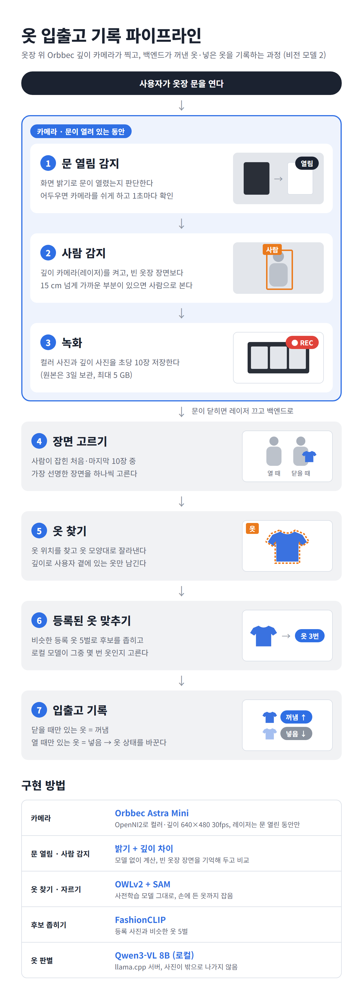

# 옷장 문 카메라 (옷 입출고 추적)

노트북 내장 카메라로 바로 쓸 수 있습니다. 카메라 앞에서 옷을 꺼내거나 넣으면
**옷을 찾고 → 입고/출고를 정하고 → 등록된 옷인지 판정해 → 시각과 함께 기록**합니다. 옷장 안 위치 감지는 이 프로그램의 범위가 아닙니다.

## 바로 실행 (Windows 노트북)
```powershell
git lfs install
git clone -b orbbec_doorcam https://github.com/kdh111000/P-Project.git
cd P-Project\Orbbec
.
un.bat
```
- 첫 실행은 `.venv`를 만들고 필요한 것을 설치합니다(약 3 GB, Python 3.10~3.13 필요). 모델 파일(약 820 MB)은 Git LFS로 받습니다.
- 옷장이 화면 **오른쪽**에 보이게 놓습니다. 왼쪽이면 `.
un.bat left`. 끝내려면 `q`.

가상환경의 파이썬으로 직접 실행할 수도 있습니다.
```powershell
.venv\Scripts\python live.py --add 이름 앞.jpg 뒤.jpg 옆.jpg
.venv\Scripts\python live.py --side right
.venv\Scripts\python live.py --video 영상.mp4 --no-window
.venv\Scripts\python live.py --state
.venv\Scripts\python live.py --resolve U2 이름
```
| 명령 | 하는 일 |
|---|---|
| `--add` | 옷 1벌 등록. 사진은 앞·뒤·옆 **3장** |
| `--side` | 카메라로 실행. `--cam 1`은 다른 카메라 |
| `--video` | 녹화본으로 실행 |
| `--state` | 옷장 안/밖과 마지막 시각 |
| `--resolve` | `확인필요`로 남은 옷을 사람이 정함(`미등록`도 가능) |

결과는 `doorcam/track.jsonl`(기록)과 `doorcam/track/*.jpg`(판정에 쓴 조각)에 저장됩니다. 사용자 사진·기록 폴더는 `.gitignore`에 있어 올라가지 않습니다.

## 동작
```
카메라 10장/초 → 26(YOLO26 s): 손에 든 옷 상자 → 포즈: 얼굴 상자 제거 → 상자를 이어 방향 판정(입고/출고)
   → 잘 보이는 조각 최대 5장 → 옷인지 확인 → 등록 사진과 비교 → 이진 분류기 p(등록)
   → 등록 / 미등록(U번호) / 확인필요(|p-0.5| < 0.075) → 상태·시각 기록
```
| 파일 | 역할 |
|---|---|
| `live.py` | 카메라·화면·입출고 판정, 실행 명령 |
| `match.py` | 조각과 등록 사진 비교(fashionSigLIP-B + DINOv2-L + 색) → 이진 분류 |
| `track.py` | 옷별 안/밖 상태와 시각. 똑같은 옷 두 벌은 두 개의 객체로 관리 |
| `test_live.py` | 방향 판정 자체 시험(모델 없이 돌아감), `python test_live.py`·`python track.py` |
| `match/held.pt` | 26: 손에 든 옷·팔·옷걸이를 찾음(YOLO26 s) |
| `match/pose.pt` | 포즈: 공식 YOLO26 n pose. 얼굴을 옷으로 잘못 잡은 상자를 버리는 데만 씀 |
| `match/match_*.pt`, `match/decider.npz` | 비교 모델과 이진 분류기 |

**학습 자료(26)**: 합성 장면 6,000장(ATR·LVIS 공개 자료) + 사람이 옷을 들고 있는 실제 장면 8,576장(Action Genome·Charades). 시험 영상의 사람·옷 장면은 학습에 넣지 않았습니다(합성 배경에 같은 옷장의 사람 없는 사진 3장만 씀).

## 측정한 정확도
45초 영상 1개(옷 5벌, 이동 7번, 손으로 표시한 장면 130장 + 빈 장면 81장), 입력 크기 640.

| 항목 | 결과 |
|---|---|
| 든 옷 찾기(IoU 0.5, 신뢰도 0.25) | 85 % |
| 빈 장면에서 잘못 찾음 | 17 % |
| 입출고 판정 | 7/7, 거짓 0 |
| 등록/미등록 판정(옷 4벌 등록, 등록 사진은 같은 영상의 다른 이동 장면) | 7/7, 두 조합 모두 |
| 처리 시간 | 장면당 약 0.17초(데스크톱 CPU). 10장/초보다 느리면 가장 최근 장면만 봄 |

**한계**
- 영상 1개, 사람 1명, 옷장 1개이고 **방향 판정 기준값은 이 영상으로 맞췄습니다.** 다른 날·다른 옷장에서 같은 성적이 나온다고 볼 수 없습니다.
- 등록 사진은 실제 휴대폰 사진이 아니라 같은 영상의 장면으로 시험했습니다.
- 등록된 옷이 하나도 없으면 미등록 옷끼리의 구분에서 1건이 `확인필요`가 됐습니다.
- **노트북 내장 카메라로는 아직 시험하지 못했습니다**(녹화본으로만 시험). 개발 PC에 카메라가 없습니다.

## 사용 조건
**비상업·연구용.** 학습에 쓴 공개 자료(DeepFashion-MultiModal, Charades 등)가 비상업 조건이고, YOLO26(Ultralytics)은 AGPL-3.0입니다. 학습 자료의 사진은 저장소에 없습니다.

---

# 이전 방식: Orbbec Astra 녹화 + Qwen3-VL 판정
아래는 `doorcam.py`·`detect.py`를 쓰는 이전 방식입니다. 위 프로그램과 따로 동작합니다.

옷장 위에 단 Orbbec Astra(깊이 카메라)가 문이 열린 동안 사용자를 녹화하고,
백엔드가 녹화본에서 옷을 찾아 어떤 옷을 꺼냈는지·넣었는지 기록합니다.

| 파일 | 역할 |
|---|---|
| `doorcam.py` | 카메라 녹화(문 열림 감지, 깊이로 사람 감지, 녹화) + 백엔드 판정(`--worker`) |
| `detect.py` | 옷 찾기: OWLv2(글자로 탐지) → SAM(픽셀 분할) → 깊이로 사용자와 함께 있는 옷만 남김 |
| `test_doorcam.py` | 가짜 프레임으로 세션 분리·녹화·판정 로직 테스트 |
| `astra_capabilities.md` | Astra Mini가 실제로 지원하는 해상도·속성 목록 (온도·레이저 직접 제어는 미지원) |

## 동작
1. **카메라**: 컬러 밝기로 문 열림 판단(닫힌 문은 빛을 막음). 깊이 레이저는 문이 열린 동안만 켬(Astra 발열 대책). 10초 넘게 어두우면 컬러 카메라도 끄고 1초마다 한 장만 찍어 밝기 확인, 밝아지면 약 2초 안에 다시 켜짐.
2. **녹화**: 문이 열린 동안 `doorcam/<시각>/colour/*.jpg`(품질 80), `depth/*.png`(16-bit mm)를 10 fps로 저장. 원본 장면은 3일 보관 후 삭제, 전체 5 GB를 넘으면 오래된 것부터 삭제(판정에 쓴 장면·결과는 문 열림 1회당 약 1 MB로 계속 보관).
3. **판정**(`--worker`): 사람이 잡힌 처음·마지막 10장 중 가장 선명한 장면 → `detect.find`로 옷 조각 추출 →
   조각마다 Qwen3-VL이 등록된 옷 중 몇 번인지 판별(FashionCLIP으로 후보 5벌) → 꺼냄 = 닫을 때만 있는 옷, 넣음 = 열 때만 있는 옷.
   후보는 상태로 제한: 닫을 때 장면은 옷장 안에 있는 옷만, 열 때 장면은 밖에 나가 있는 옷만 비교.



## 실행
```bash
python doorcam.py --closet <옷장코드> --show   # 카메라(실시간 창: b = 빈 장면 기억, q = 종료)
python doorcam.py --worker                     # 백엔드 판정
python doorcam.py --stop                       # 카메라 정상 종료(레이저 끔). 강제 종료하면 레이저가 켜진 채 남을 수 있음
python test_doorcam.py
```

## 준비물
- Astra (USB 2BC5:0404) + Orbbec OpenNI2 SDK 폴더(`OPENNI2_DIR`, 기본 `~/Downloads/Orbbec/OpenNI2/sdk/libs`), `pip install openni`
- `transformers`, `torch`, `torchvision`, `opencv-python`, `pillow` (모델: `google/owlv2-base-patch16-ensemble`, `facebook/sam-vit-base`)
- 판정 단계는 Fitmate 옷장 서버 모듈(`web.py`, `extract.py`, `retrieve.py`)과 로컬 Qwen3-VL 서버(아래)를 씁니다. 옷장 서버 모듈은 이 브랜치에 포함돼 있지 않습니다.

## 로컬 Qwen3-VL 서버 (llama.cpp)
모델 파일(5.8 GB)은 GitHub 파일 크기 제한(100 MB)을 넘어서 저장소에 넣지 않습니다. 각자 받아서 띄웁니다.

| 항목 | 값 |
|---|---|
| 모델 | [`Qwen/Qwen3-VL-8B-Instruct-GGUF`](https://huggingface.co/Qwen/Qwen3-VL-8B-Instruct-GGUF) 의 `Qwen3VL-8B-Instruct-Q4_K_M.gguf` (5.0 GB) |
| 비전 인코더 | 같은 저장소의 `mmproj-Qwen3VL-8B-Instruct-Q8_0.gguf` (0.75 GB) |
| 서버 | [llama.cpp 릴리스](https://github.com/ggml-org/llama.cpp/releases) Windows x64 빌드. 우리는 b12176 Vulkan 빌드 사용 (AMD RX 580). NVIDIA는 CUDA 빌드 |

**1. 모델 받기**
```bash
pip install -U huggingface_hub
hf download Qwen/Qwen3-VL-8B-Instruct-GGUF Qwen3VL-8B-Instruct-Q4_K_M.gguf mmproj-Qwen3VL-8B-Instruct-Q8_0.gguf --local-dir models
```

**2. 서버 실행** (llama.cpp 압축을 푼 폴더에서)
```bash
llama-server -m models/Qwen3VL-8B-Instruct-Q4_K_M.gguf --mmproj models/mmproj-Qwen3VL-8B-Instruct-Q8_0.gguf -ngl 99 -c 4096 -np 1 --host 127.0.0.1 --port 8090
```

**3. 확인**
```bash
curl http://127.0.0.1:8090/health
```
`{"status":"ok"}`가 나오면 준비 완료. 코드는 OpenAI 호환 주소 `http://127.0.0.1:8090/v1/chat/completions`로 요청합니다.

**주의**
- `-c 4096` 유지: GPU 메모리 8 GB(RX 580)에서 `-c 8192`로 올렸더니 답이 `GGGG...`로만 나왔습니다.
- 4096에서도 오래 켜 두면 가끔 같은 `GGGG...` 상태가 됩니다. 이때는 서버를 재시작하면 됩니다. 코드는 이 답을 서버 고장으로 보고 해당 기록을 오류로 남겨 나중에 다시 판정합니다.
- `-ngl 99` = 모든 층을 GPU에 올림. GPU 메모리가 부족하면 숫자를 줄이세요(일부는 CPU에서 돌아 느려짐).
- 한 번에 사진 약 20장까지(문맥 4096 토큰)라 판정은 조각마다 따로 묻습니다.

## 확인된 것 / 한계
- 저장 사진 기준 비교: SegFormer는 손에 든 옷을 티셔츠와 합침, Grounding DINO는 흔들린 든 옷을 놓침, OWLv2+SAM이 둘 다 잡음.
- 등록 사진 합성 4건(든 바지 무시, 갈색 재킷 꺼냄, 군복 꺼냄, 갈색 재킷 넣음) 모두 정답. 실제 옷장 장착 상태 검증은 아직.
- CPU 기준 기록당 1분 안팎. 기준값(`DARK`, `CLOSER_MM`, `MIN_SCORE` 등)은 장착 후 조정 필요.
